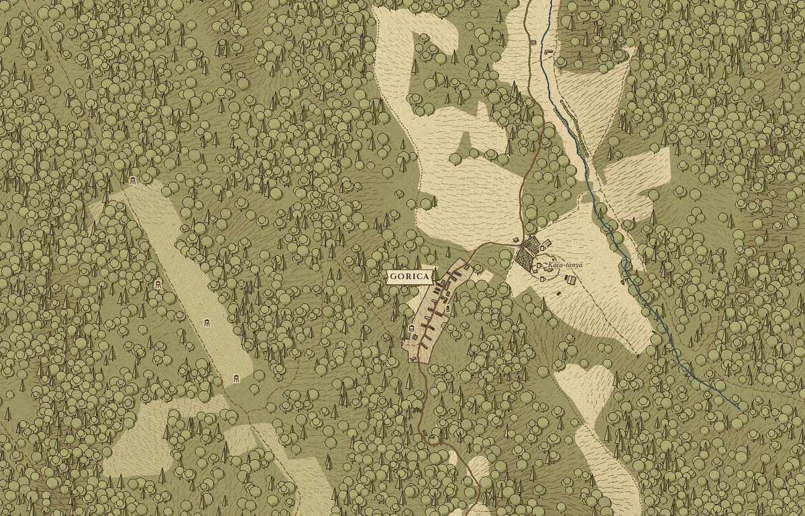

# inkmap

Real places drawn as a hand-engraved old map: parchment, hachured hills, stamped trees and
houses, hand-drawn roads, serif names on ribbons. The data is OpenStreetMap, an open elevation
model and ESA's tree cover; the output is a static tile pyramid you can pan in a browser, or a
single image for an e-paper frame or a print.

It is a command line tool in Python. Nothing is served at view time: render once, host the folder.



## Setup

```sh
python3.12 -m venv .venv && .venv/bin/pip install -r requirements.txt
brew install osmium-tool        # cuts the OSM extract
```

## Use

A region is a TOML file: a name, a title, a bounding box, which scales to draw, and optional
extras (GPX tracks the names keep clear of, a smaller box for the finest scale, large region
names). `regions/gorica.toml` is the annotated example.

```sh
.venv/bin/python -m inkmap fetch  regions/gorica.toml   # OSM extract, elevation and tree-cover tiles into data/
.venv/bin/python -m inkmap render regions/gorica.toml   # draws every scale, cuts tiles/gorica/{z}/{x}/{y}.webp
python3 -m http.server -d site 8000                     # a local Leaflet page to pan the result
```

`tiles/<name>/meta.json` carries the size, zoom range, bounding box, any windowed scale and the
box every name was drawn in, so a viewer can highlight a name on the map itself.

## Layout

- `inkmap/domain/`: the frame projection and region definitions. Standard library only.
- `inkmap/render/`: the engraving: fills, relief, stamps, lines, labels. `fonts/` holds the OFL faces.
- `inkmap/sources/`: OSM PBF extracts via osmium, elevation and tree-cover tiles over HTTP.
- `inkmap/tiles.py`: slices a rendered scale into a pyramid and writes `meta.json`.
- `site/`: the local viewer. `regions/`: region files. `data/` and `tiles/` are ignored.

Checks: `.venv/bin/pytest` and `.venv/bin/ruff check .`.

## Data and attribution

- Map data © OpenStreetMap contributors, ODbL. Every public render must carry this line.
- Elevation: Terrarium tiles (Mapzen / AWS Open Data).
- Tree cover: ESA WorldCover, CC BY 4.0.
- Fonts: Cinzel and Libre Baskerville, SIL Open Font License (texts next to the files).

The style is a style-alike of hand-engraved game and atlas maps. No game assets, fonts or
place names are used; every sprite is drawn here.

## Licence

MIT, see `LICENSE`. Fonts keep their own OFL.
